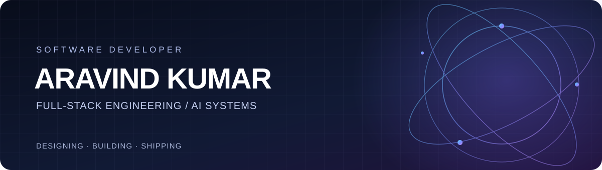

  
<strong>Software Developer · Full-Stack Engineering · AI Systems</strong>

  
Building web products, dependable backend systems, and intelligent application experiences.

  

    <a href="https://www.linkedin.com/in/aravind-kumar-r-dev5500/">LinkedIn</a>
    &nbsp;·&nbsp;
    <a href="https://github.com/Aravindkumar5500">GitHub</a>
    &nbsp;·&nbsp;
    <a href="mailto:aravindrps75@gmail.com">Email</a>
  

---

## About

I'm a software developer who enjoys building products across the stack — from clear, responsive interfaces to backend APIs, data workflows, and AI-powered features.

- **Current role:** Software Developer at **Nearle Technologies**
- **Previous experience:** **Tenext Technologies**, where I worked on **Friendbuy**
- **Based in:** Coimbatore, India
- **Interests:** Full-stack engineering, system design, AI agents, and practical LLM applications

## Technologies

**Frontend**  

**Backend & Data**  

**Tools & AI**  

---

## Selected Work

<table>
  <tr>
    <td width="50%" valign="top">
      <h3>Owliver</h3>
      
<strong>Context-aware operational assistant</strong>

      
Worked across the assistant interface, backend APIs, and agent-driven capability architecture.

      <ul>
        <li>Built page-aware assistant experiences for Schedule, Order Management, and Control Center.</li>
        <li>Worked with PostgreSQL-backed agent and skill APIs, suggestions, and runtime interfaces.</li>
        <li>Contributed to an agent-to-skill execution model connecting application context to the LLM layer.</li>
      </ul>
      Full-stack · PostgreSQL · Agent/skill architecture · AI workflows
    </td>
    <td width="50%" valign="top">
      <h3>Loyaly</h3>
      
<strong>Retail intelligence & loyalty platform</strong>

      
Worked on both merchant-facing and customer-facing dashboard experiences.

      <ul>
        <li>Merchant dashboard: operations, analytics, business insights, and loyalty campaign workflows.</li>
        <li>Customer dashboard: digital wallet, LYTs rewards, and personalized engagement.</li>
        <li>Platform ecosystem: Behavision, SpendSense, Dyscount, and Identiq.</li>
      </ul>
      React · Next.js · TypeScript · Retail technology · Loyalty
    </td>
  </tr>
  <tr>
    <td width="50%" valign="top">
      <h3>Friendbuy</h3>
      
<strong>Referral & loyalty SaaS</strong>

      
Previously worked on Friendbuy at <strong>Tenext Technologies</strong>.

      <ul>
        <li>Developed Shopify checkout extensions and referral experiences.</li>
        <li>Built a Thank You page announcement bar and referral modal.</li>
        <li>Worked on reward workflows, campaign configuration, and email merge variables.</li>
        <li>Contributed to Online, POS, and All-channel analytics.</li>
      </ul>
      React · TypeScript · Shopify · Backend APIs · Analytics
    </td>
    <td width="50%" valign="top">
      <h3>Doormile & Nearle Website</h3>
      
<strong>Modern web experiences</strong>

      
Built responsive website experiences with reusable frontend components, motion, and interactive 3D elements.

      <ul>
        <li>Next.js and TypeScript interfaces.</li>
        <li>GSAP-powered animations and transitions.</li>
        <li>Three.js visual experiences.</li>
        <li>Responsive layouts and frontend performance.</li>
      </ul>
      Next.js · TypeScript · GSAP · Three.js
    </td>
  </tr>
</table>

---

## Current Learning

- Designing scalable backend services and clean application architecture.
- Building reliable LLM applications, agent orchestration, and tool execution.
- Exploring embeddings, Retrieval-Augmented Generation (RAG), and AI evaluation.

---

  <strong>Thanks for stopping by.</strong>
  
I'm always interested in thoughtful products, engineering challenges, and opportunities to learn.

  <a href="https://www.linkedin.com/in/aravind-kumar-r-dev5500/">Connect on LinkedIn</a>

